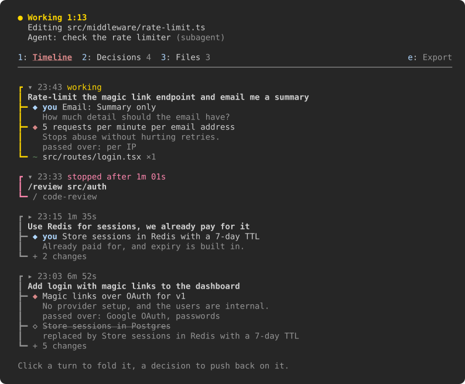
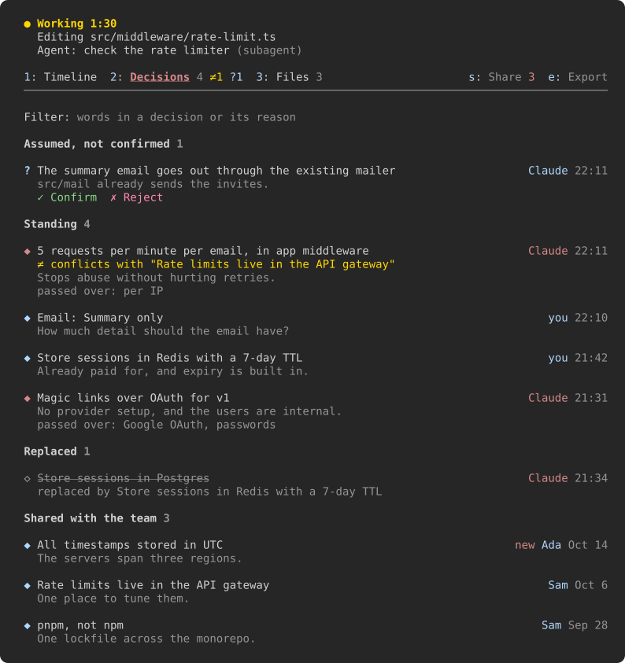
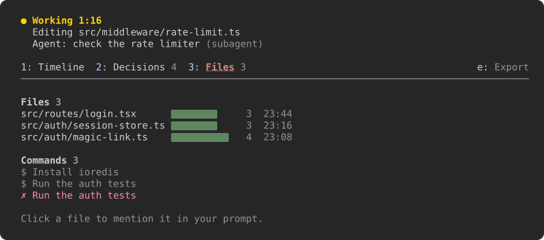
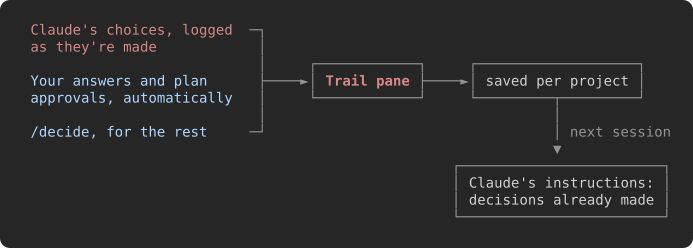

# Trail

**A side pane for Claude Code that keeps the record of a session: what you asked, what got decided, by whom and why, and what changed.**

Three turns into a session nobody remembers why it's Redis and not Postgres, which files moved, or whether Claude is still working or waiting on you. Trail writes that down as it happens, right beside the conversation, hands the decisions back to Claude next time so they stick, and flags it when a new one quietly goes against them. One command puts them in the repo, so your whole team's Claude sessions work from the same list.

<p align="center">
  
</p>

## Install

At the prompt of a Claude Code session in your terminal:

```text
/plugin install trail --marketplace m3talen/claude-trail
```

Answer `y` to add the marketplace, then pick a scope (user scope puts it in every session).

From a shell:

```sh
claude plugin install trail --marketplace m3talen/claude-trail
```

In the desktop app, where `/plugin` does not run: click **+** next to the prompt box, then **Plugins**, **Add marketplace** with `m3talen/claude-trail`, then **Add plugin**.

> [!NOTE]
> Trail is a function-hooks mod, an early-access part of Claude Code. It was built and tested on Claude Code 2.1.303, and the mod API can change between releases.

The pane docks beside the transcript in the fullscreen layout and opens by itself on terminals 144 columns or wider. Anywhere else, `/trail` opens it.

## What you see

### Timeline

Every turn is a run on a rail, coloured by how it went: amber while Claude works, red if you stopped it, grey once done. Its decisions hang off the rail as `◆`, its changes as `~` edits, `$` commands, `→` agents and `/` skills. The newest two turns are open; click any turn's header to fold or unfold it.

The top line always says what's happening now: `● Working 1:13` with what Claude is doing, `● Background` while a subagent runs on, a ` Needs you ` badge when Claude is waiting on your answer or a plan approval, and `○ Idle` when it's done.

### Decisions

<p align="center">
  
</p>

Every decision of the session, split into **Standing**, **Replaced**, **Shared with the team** and **From earlier sessions**, with who made it, when, the reason and what was passed over. A decision that contradicts one still in force is marked `≠ conflicts with "…"`, and the tab shows how many are open. Type in the filter to narrow them. Click a decision and `Revisit "<decision>": ` lands in your prompt, ready for you to push back.

### Files

<p align="center">
  
</p>

Each file changed this session, with how often and when it was last touched, and the commands that changed things (failures in red). Click a file to put `@path` in your prompt.

## How decisions get in

<p align="center">
  
</p>

- **Claude's own.** Trail gives Claude a `decide` tool and a short instruction: log a non-obvious choice (an approach, a library, a scope cut, an assumption) at the moment it's made, with the reason and what it passed over. When a choice changes an earlier one, Claude names it and the old one is struck through as replaced.
- **Yours.** Answers to Claude's multiple-choice questions and plan approvals are logged as yours automatically. Anything else, log it yourself:

  ```text
  /decide use SQLite because it's one user and no server
  ```

- **Next time.** Decisions are kept per project folder. When a new session starts there, Claude is given the team's decisions and your last 20 that still stand, so it doesn't relitigate them.

Reads and read-only commands never show up: they're most of the tool calls and change nothing.

### Contradictions

Each decision Claude logs (without `replaces`), and each of your `/decide`s, is checked against the ones still in force: this session's, your earlier sessions' and the team's. A small model (Haiku) answers one question: can both hold at once? "Redis for sessions" against "Postgres for sessions" can't; "Session TTL of 7 days" against "Redis with a 7-day TTL" can.

When they can't, the new decision is logged anyway and marked `≠` in the pane, and Claude is told which decision it goes against and who made it, so it asks you before acting on it. If you meant the change, Claude logs it again with `replaces`, the old one is struck through, and the mark clears.

## Share decisions with your team

`/trail share` (or **s** in the pane) writes this project's standing decisions to `.claude/decisions.md`:

```markdown
# Decisions

What this project has settled, one per line. Claude reads this list at the start of every session through [Trail](https://github.com/m3talen/claude-trail), and `/trail share` adds a session's decisions. Edit it like any other file.

- **Rate limits live in the API gateway** — One place to tune them. _(Sam, 2026-10-06)_
- **Store sessions in Redis with a 7-day TTL** — Already paid for, and expiry is built in. _(Claude, 2026-10-19)_
```

Commit it and everyone on the team who runs Trail gets the same list in every session. The pane counts what a share would change (`Share 3`).

- **It's an ordinary file.** Any bullet counts as a decision, the bold part as its text. Write them by hand, reword them, group them under headings; a share only adds new lines at the end and takes out replaced ones, leaving the rest as you wrote it.
- **Nothing is committed for you.** Trail writes the file only when you share; reviewing and committing it is up to you, like any other change.
- **Replacing works across the team.** When Claude replaces a team decision, it's struck through in the pane, and the next share takes it out of the file.
- **Conflicts wait.** A decision marked `≠` stays out of the file until the conflict is settled, so the team never gets two decisions that can't both hold.
- **Names come from git.** Your decisions are signed with `git config user.name`; Claude's say Claude.

## Commands

| Command | What it does |
|---|---|
| `/trail` | Open the pane |
| `/decide <what> [because <why>]` | Log a decision of yours |
| `/trail share` | Write this project's standing decisions to `.claude/decisions.md` for your team |
| `/trail export` | Save this session's trail to `.claude/trail/<date>.md` in your project |
| `/trail clear` | Empty this session's trail |
| `/trail forget` | Forget this project's decisions from earlier sessions (the team file stays) |
| `/trail demo` | Fill the pane with sample data, in a fresh session (nothing is saved) |

With the pane focused (click it, or **ctrl+x tab**): **1**, **2** and **3** switch tabs, **s** shares and **e** exports.

## What it keeps, and what it costs

- **Your decisions stay local until you share them.** The timeline lives in the session; decisions are saved in Claude Code's local store for the plugin, keyed by project folder. The only file Trail writes in your project is the one you ask for (`/trail share`, `/trail export`).
- **One small model call per decision logged**, to check it for contradictions: Haiku, through your own Claude Code session, sent the new decision and the standing ones (up to 60), with their reasons, and nothing else. It's skipped when there's nothing to check against.
- **Two short additions to Claude's instructions:** when to log a decision, and the decisions still standing (the team's, then yours). That list changes only when a session starts, the team file changes, or an earlier decision is replaced, so it doesn't churn the prompt cache.

## Develop

```sh
git clone https://github.com/m3talen/claude-trail
cd claude-trail
claude --plugin-dir .
```

Saving a file reloads the mod in that session. Then:

```sh
claude plugin validate .
claude plugin test .
```

`claude plugin test` runs the behaviour tests in `tests/` against Claude Code's own engine. Claude Code writes the API's type declarations into `.claude-plugin/types/` when it loads the mod, after which `npx tsc -p .` type-checks it.

The screenshots in `docs/` are captures of a real terminal running `/trail demo`.

## License

[MIT](LICENSE)
